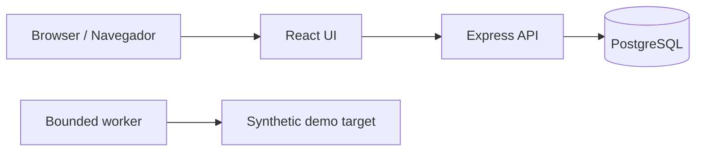

# Architecture / Arquitetura

## Decision / Decisão

The first vertical slice uses four small processes rather than embedding experiments in the web server. This keeps authentication and data access in the API, presentation in the web app, synthetic target data in the demo app, and future execution controls in the worker. A scan request cannot arrive through the foundation UI or API because that endpoint does not exist yet.

A primeira fatia funcional usa quatro processos pequenos. A API concentra autenticação e acesso a dados; a interface cuida da apresentação; o alvo de demonstração contém apenas dados sintéticos; e o worker concentra os limites de execução. Ainda não existe rota para iniciar scanners pela interface ou pela API.

## Trust boundaries / Limites de confiança

- Host ports bind to loopback. Container DNS names are internal to the Compose network.
- Auth uses an opaque session cookie; the database stores a digest of the token.
- The worker uses one exact configured origin and fixed read-only paths. No user-supplied URL is accepted by the foundation.
- The target holds synthetic records. It contains no intentionally vulnerable routes.
- Secrets and generated reports stay out of Git via `.gitignore` and the documented workflow.

## Later phases / Próximas fases

Tool adapters, job queues, telemetry collection, and scanner workflows require their own threat model and verification. Listing a planned module in the dashboard is not evidence of integration.

Adaptadores de ferramentas, filas, coleta de telemetria e fluxos de scanner exigem modelo de ameaças e verificação próprios. Um módulo marcado como planejado no painel não constitui integração.
