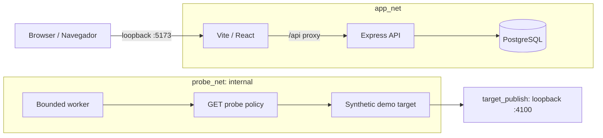

# Architecture / Arquitetura

## Decision / Decisão

The first vertical slice uses four small processes rather than embedding experiments in the web server. This keeps authentication and data access in the API, presentation in the web app, synthetic target data in the demo app, execution controls in the worker, and the bounded probe adapter in a separate scanner package. A scan request cannot arrive through the foundation UI or API because that endpoint does not exist yet.

A primeira fatia funcional usa quatro processos pequenos. A API concentra autenticação e acesso a dados; a interface cuida da apresentação; o alvo de demonstração contém apenas dados sintéticos; o worker controla a execução; e um pacote separado contém a política e o adaptador da sonda. Ainda não existe rota para iniciar scanners pela interface ou pela API.

## Trust boundaries / Limites de confiança

- Host ports bind to loopback. `app_net` connects web, API, and PostgreSQL. `probe_net` is internal and connects only the worker and synthetic target; `target_publish` permits the demo target's loopback port publication.
- The browser reaches the API through Vite's `/api` proxy. `FRONTEND_ORIGIN` is an exact allowlist for `http://127.0.0.1:5173` and `http://localhost:5173`; CORS responses only echo a matching origin. Cookies are not isolated by port, so other local tools should not share the dashboard host. A dedicated host name is deferred.
- Auth uses an opaque session cookie. PostgreSQL stores only the token digest. `API_HOST` and `DEMO_TARGET_HOST` default to loopback; `0.0.0.0` requires `AEGISLAB_IN_CONTAINER=1` and Compose publishes host ports on loopback only.
- Register and login limits are keyed by the socket IP, with 5 and 10 attempts per 10 minutes respectively, including successful attempts. Vite proxy traffic shares a socket bucket. `X-Forwarded-For` is not trusted.
- The worker permits one exact origin and fixed read-only paths. A local run accepts only `127.0.0.1:4100`; the Compose service name is accepted only with the container flag. The response body is canceled before the next request, and redirects are not followed. No target URL enters through the UI or API.
- The target holds synthetic records and no intentionally vulnerable routes. Structured JSON lines record only approved event fields, without email, passwords, cookies, query strings, or exception messages. These logs are not OpenTelemetry or Prometheus integration.
- Secrets and generated reports stay out of Git and the Docker build context. Scrypt queueing in the Node thread pool is a hypothesis for future load tests, not an observed performance result.

- As portas do host ficam em loopback. `app_net` liga interface, API e PostgreSQL. `probe_net` é interna e liga apenas o worker ao alvo sintético; `target_publish` permite publicar a porta do alvo em loopback.
- O navegador acessa a API pelo proxy `/api` do Vite. `FRONTEND_ORIGIN` aceita exatamente `http://127.0.0.1:5173` e `http://localhost:5173`; o CORS devolve apenas a origem correspondente. Cookies não são isolados por porta, portanto outras ferramentas locais não devem compartilhar o host do painel. Um nome de host dedicado fica para outra fase.
- A autenticação usa um cookie de sessão opaco. O PostgreSQL armazena somente o resumo do token. `API_HOST` e `DEMO_TARGET_HOST` usam loopback por padrão; `0.0.0.0` exige `AEGISLAB_IN_CONTAINER=1`, e o Compose publica as portas do host somente em loopback.
- Os limites de cadastro e login são por IP do socket: 5 e 10 tentativas a cada 10 minutos, inclusive sucessos. O tráfego pelo proxy Vite compartilha um mesmo limite. `X-Forwarded-For` não é confiável.
- O worker aceita uma origem exata e caminhos fixos de leitura. Localmente, só aceita `127.0.0.1:4100`; o nome do serviço Compose exige a indicação de contêiner. Cada corpo de resposta é cancelado antes da próxima chamada, sem seguir redirecionamentos. A interface e a API não recebem URLs de alvos.
- O alvo contém registros sintéticos, sem rotas intencionalmente vulneráveis. Logs estruturados em linhas JSON registram apenas campos aprovados, sem e-mail, senha, cookie, consulta ou mensagem de exceção. Eles não constituem integração OpenTelemetry ou Prometheus.
- Segredos e relatórios gerados ficam fora do Git e do contexto de build. Uma fila de scrypt no pool de threads do Node é hipótese para testes de carga futuros, não resultado medido.

## Later phases / Próximas fases

Tool adapters, job queues, telemetry collection, and scanner workflows require their own threat model and verification. Listing a planned module in the dashboard is not evidence of integration.

Adaptadores de ferramentas, filas, coleta de telemetria e fluxos de scanner exigem modelo de ameaças e verificação próprios. Um módulo marcado como planejado no painel não constitui integração.
